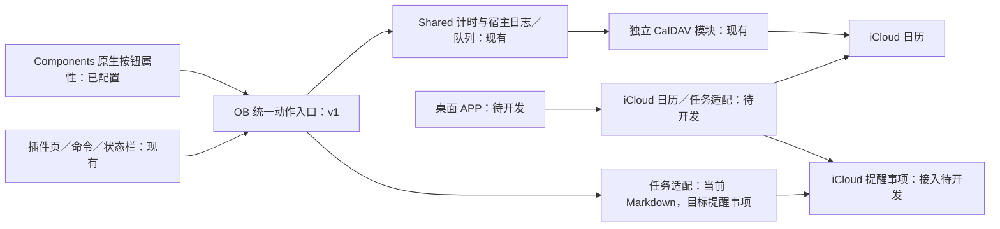

# 产品架构与分阶段接入

基线：2026-11-01。需求以 [产品需求](1-产品需求.md) 为准。当前软件为 OB 插件 0.4.0；本文的目标模块、接口和流程不等于已经实现，不创建空工程。

0.3.4 更新：NoteTaskModal 使用可复用 noteTaskForm，仅显示固定标题和分类选择。新课题按文件名去.md创建；默认选择插件默认分类，不可用时要求选择。确认后在本地execute锁中先保存稳定绑定／任务快照，再用MarkdownTasks.configureBound原子创建任务；保存绑定失败不写任务，任务写失败则下次从原绑定恢复，避免重复。配置已有绑定只更新分类，保留标题／完成历史；startFromNote随后沿用API开始／恢复同一会话。noteChoices共享同笔记在途选择，活动计时期间拒绝新配置。CRLF文件新任务行保持原换行。

0.3.3 更新：仅调整顶部栏，移除完整日历按钮及过期的错误回退提示，仍通过内嵌 FCR 日历页操作。刷新／设置按钮由无障碍名称＋内联 SVG 渲染；页签分段式，活动标识压缩为圆点并保留 aria-description。窄栏按容器宽度缩减间距和页签字号，不新增监听器或计时器。

0.3.2 更新：执行记录只投影有 recordId 的工时区间，取消完成事项卡片、勾号和相关空状态文案。完成记录仍留在原有数据及待办状态中；不删除日志或重写日记。

0.3.1 更新：计时页不再渲染待办候选，保留旧设置数据但撤下入口；任务筛选以 details 弹层显示，页签与工具合并为顶部一行。任务编辑复用已有确认删除表单；MarkdownTasks.remove 按稳定 ID／完整任务快照拒绝过期删除，仅移除任务与分类行，保留工时／完成历史。

Components 的 componentTaskBindings 保持原 TaskRef，另存 componentTaskSnapshots。删除前先持久化关联任务的标题／截止／分类快照，再原子删除行。TimerApi.start 将入口上下文传给宿主 resolve；仅在有效笔记＋完全匹配已有绑定的 Components 入口、无冲突活动会话且分类可写时，原子 restoreBound：已有未完成任务不变，已完成任务取消勾选，已删除任务用原 ID 重建。校验／恢复／启动同处本地动作锁，重复点击仍幂等。其他来源不自动复活任务；重建不创建完成事件、不写云端或重放旧日志。没有旧快照时以对应课题文件名和默认分类恢复，不用标题查找别的任务。

## 0. 0.4.0 当前日历与布局边界

`Coding/Providers/Calendar/` 实现独立 CalendarBridge／CalendarEngine／DavClient／iCalendar 适配，不导入 Obsidian 或 FCR。宿主 `calendarStorage.ts` 封装 requestUrl、受保护凭据和原子缓存文件；`calendarSettings.ts` 提供来源发现／配置与显示偏好。FCR 仅作为一次性配置导入文件的位置，不调用其插件 API，也不复制其实现；旧 Providers/Fcr 仅供历史回归夹具，产品入口不导入。

首次导入保留来源 ID，凭据写到本插件的库级 secretStorage 键。迁移失败不清空原设置、不阻止插件设置页打开。缓存按来源和服务器／账号身份区分；完整资源索引＋ETag 增量下载，最多三个并发读、每来源串行，失败不发布空快照。晚到的旧连接响应不能回填新连接；缓存跨实例共用写入队列，旧实例不能覆盖新实例。

写入沿用共享 Controller／SyncWorker 的本地日志与 UID 检查点；创建 If-None-Match、更新／删除先 GET 并核对内容，再 If-Match，丢响应可按 UID 和目标内容重认领。修改在原 ICS 上更新自有字段，保留提醒、参与人、自定义属性与周期例外；跨分类复制保留原资源。UTC 工时保持原语义，IANA 周期保留 TZID 和夏令时，全天为浮动日期／排他结束日。周期单次实例编辑和 RANGE=THISANDFUTURE 特殊变更尚无专用 UI，不暗中改为单次操作。

`calendarPanel.ts` 自带 FullCalendar 7，月／周／日／列表、普通事件拖动和缩放、来源显示筛选；首次进入懒加载单实例，隐藏切页保留，关闭释放订阅与观察器。其事件投影合并相同日志的本地待同步操作，时钟不触发查询。导航在 `.ctt-scroll` 外作为固定 flex 子项，不使用覆盖内容的 sticky 定位；待办只显示待办，计时和执行记录共用该内容滚动区。

真实验证与模拟回归分开记录于最新开发日志。独立真实读写与隔离渲染成功不等于自动重载完整新版宿主；已安装 FCR 暂保留供旧运行实例使用，用户加载新版后可停用。

以下保留 0.3.x 应用边界及历史设计；与本节冲突时以本节为准。

## 1. 现状与目标

| 层面 | 现有实现 | 目标 |
| --- | --- | --- |
| 科研上下文 | OB 笔记；插件只读取配置的待办文件 | 课题／笔记保留 OB，行动任务有稳定关联，可从 Components 卡片计时 |
| 任务主记录 | Markdown 稳定 ID、日期和分类元数据 | 真正 iCloud 提醒事项统一保存行动任务；OB 只保留关联、展示和未确认草稿 |
| 日历 | 通过独立 CalDAV 适配读写 iCloud 日历 | 日程、生活补记、科研工时进入同一 iCloud 日历体系；保持分类与 UID |
| 活动计时 | 本 OB 插件实例的一份 Controller／私有日志，可选 ownerDeviceId | 未来桌面与 OB 共享活动会话并支持接管；本轮只落实接口边界 |
| 桌面端 | 尚未开发 | 独立于 OB 运行，读取任务／摘要，快速补记和安排；布局待定 |
| 提醒事项 | 独立 Python 探针，已有部分真实验证 | 经最小组件封装后接入；周期与字段保护另验收 |

现有 Markdown 保留为任务兼容实现，日历已由独立 CalDAV 模块接管，不重写运行中的日志。统一 iCloud 是目标，不能将探针或本地文件同步宣传成已接入的提醒事项。

## 2. 数据权威与本地状态

| 内容 | 权威位置 | 本地内容 |
| --- | --- | --- |
| 行动任务、完成和重复规则 | iCloud 提醒事项（目标） | 缓存、待提交草稿、同步进度；迁移前旧 Markdown 明确标为本地 |
| 未来日程、实际补记和工时 | iCloud 日历 | 缓存、稳定 UID、操作确认日志 |
| 课题背景、论文、实验笔记 | OB 原有笔记 | 按用户现有笔记管理方式保存，不自动上传正文到提醒事项 |
| 安排日期、截止日期、课题关联 | iCloud 任务对应信息（目标，映射待验） | 缓存、恢复用关联；不能悄悄退化为仅本地字段而声称跨端同步 |
| 活动计时与暂停区间 | 当前为发起设备日志；未来远端会话权威待实现 | 本地恢复日志与设备身份，未来接管互斥／冲突处理独立验收 |
| 密码、令牌、Cookie | 宿主受保护存储 | 不进入普通日志、Markdown、Components 参数或 Git |

iCloud 共享业务结果不自动协调各进程的秒表。用户已确认未来桌面也要共享活动会话并接管；当前加入可选设备身份与 SessionStore 边界，仍只有本机 Controller，不声称本轮实现远端互斥、离线接管或桌面客户端。

### 0.3.0 已实现的应用与视图边界

- `Shared/application.ts` 定义 TaskRef、TaskCompletion、TaskRepository、CalendarQuery、SessionStore、筛选／重要任务选择器和 ApplicationState。任务、会话、执行记录、同步状态分片通知；视图订阅在微任务中合并，卸载清理。Obsidian 适配器处理文件与窗口，业务选择器不导入 Obsidian／文件系统。
- 同一 TimerController 和 SyncWorker 贯穿三页；页签只切换可见面板，各自保留草稿／筛选／滚动。每秒 tick 只改时长与运行状态文本，不调用日历查询或重画完整列表。`TimerApi v1` 保留，新增 `getTimerState()`／`subscribeTimer()` 供 Components 轻量订阅；旧 API 完整状态订阅仍兼容。
- MarkdownTasks 的 `setCompleted` 在一次 vault.process 中写勾选及 `ctt-completions` 自有注释。事件含稳定引用、标题／分类快照、UTC 毫秒时间点和唯一 ID；重复期望状态幂等。取消完成不删历史，重完成新增事件。损坏／重复元数据停止写入。执行记录在本地日期投影，旧外部勾选不生成猜测时间。
- JournalStore 实现 SessionStore，保留原 schema／记录身份／待同步队列；新增 Session.ownerDeviceId 为可选，旧日志可读。其文件路径仍只用于本机 Worker 的协调频道，不代表远端会话锁。
- FcrBridge 实现 CalendarQuery.readDay，来源缓存未齐或读取异常时不返回空快照覆盖旧数据；宿主按日期保留最多 14 份有效快照。任务页只投影工时与完成事件，完整日程留给日历页，日记接口保持原行为。
- `calendarPanel.ts` 由 Obsidian Component 托管 FCR 的 MarkdownRenderer `fc-calendar`，首次进入懒加载单实例、月视图。切页不销毁、不随时钟刷新；关闭视图释放 child 与根 DOM。FCR 内部使用可见性观察，隐藏容器不会立即绘制。未复制其内部设置、连接或同步实现。

原生 FCR 嵌入已在真实 Obsidian 的隔离组件中验证绘制与释放；三页计时／网络延迟／大数据检查在浏览器模拟端口完成。新插件整机重载后真实跨页及云端往返仍需单独验收，不能互相替代。

## 3. 复用与接入结构

| 位置 | 保留／扩展职责 |
| --- | --- |
| `Coding/Shared` | 模型、时间、计时、队列与幂等规则；继续不导入窗口、OB 或文件系统 |
| `Coding/Clients/Obsidian` | 统一动作入口、任务上下文、UI、Markdown 兼容与 Components 适配；不另写计时算法 |
| `Coding/Providers/Calendar` | 当前独立日历通道，CalDAV／ICS、条件写入、缓存与周期展开 |
| `Coding/Probes/IcloudReminders` | 验证工具和原始实测依据，不当作产品 API 直接供按钮调用 |
| 目标日历／提醒事项适配 | 把已验证能力封装成最小接口，认证留在受保护组件；具体目录在实现时建立 |
| 目标桌面客户端 | 独立使用 iCloud 适配，不依赖 OB／FCR 正在运行；不预定完整月视图或窗口框架 |

FCR 是 OB 插件，不能拿它的缓存对象直接给独立桌面 APP 使用。桌面通道需具备独立的认证／生命周期，遵守相同 UID 和业务规则；不为当前 Components 接入提前复制全部 FCR。

## 4. P1：OB／Components 的具体接入设计

0.2.20 主页面只由 `.ctt-shell` 承担纵向滚动；宿主仍用独立 mount 隔离 OB 主题的 padding／overflow。`.ctt-body` 按内容高度展开、不占用剩余视口高度，列表取消 overflow:auto 和滚动隔离，计时区和标题随外层一起滚动。宽屏网格按原 1:2 双列并顶部对齐，窄屏纵向排列保持横向撑满。删除只用于受限列高的密度 ResizeObserver／动画帧和卡片压缩逻辑；正常刷新继续复用列表节点以保留外层滚动和焦点。同步弹层／编辑对话框独立限制高度的逻辑不变，主页面没有嵌套列表滚动区。

日记创建后的自动入口位于 `DiaryAutoUpdate.templater.md`，部署到用户既有 Daily Template 底部。它在渲染时捕获目标库内路径，通过 Templater 的 `on_all_templates_executed` 等待模板保存后才解析当前插件实例并调用既有 updateDiaryFromNote；闭包布尔值保证重复完成信号也只调用一次。普通文件编辑不运行该入口，不使用 vault modify 递归监听或固定延时抢写；每篇日记仍由 DiaryUpdater 校验范围、备份、保护并发并写生成区。异常在完成回调内部捕获并提示手动重试，不影响日记创建。触发代码执行后不进入笔记正文，生成内容仍是普通 Markdown。

0.2.18 的待办列表继续作为同一 UI 的投影：分类页签点击时将新增栏预填为筛选分类，“全部”预填全局默认；手动覆盖仅留在当前输入中，刷新保留，添加成功或切换筛选后重置。筛选分类被隐藏／移除时退回“全部”并重置预填，不修改默认设置或已有待办分类。任务行按 kind＋稳定 ID＋本地路径（旧 FCR 任务按来源日历）关联活动会话，避免不同待办文件同 ID 被误认为当前任务。高亮／暂停／运行状态由同一 ViewModel 决定，累计时长只用现有宿主 tick 和 elapsed 更新，不新建订阅或定时器；行内暂停／继续传明确会话 ID 到现有 API，离线仍可操作本地活动计时。

当前按用户 2026-10-31 的明确纠正接入：Components 原生按钮属性选择“运行脚本”，表达式 `CalendarTaskTimerStart()`。脚本通过 Components 官方扩展加载器获得 `this.currentFile`，调用同一插件实例的 `toggleFromNote(notePath)`（原 `startFromNote` 保留）；不依赖当前活跃文件是课题笔记（首页可以仍是 Home.components）。不在 MD 中嵌入控件，不改封面，不新增按钮或独立计时器。插件只装饰原生字段的显示与事件。

适配脚本源码为 `Coding/Clients/Obsidian/CalendarTaskTimerStart.js`，部署到 Components 配置的脚本目录；它只传课题路径，不持有令牌或写日志。用户已创建的按钮属性保留名称／顺序／样式，仅补表达式。课题→TaskRef 存于插件 `componentTaskBindings` 设置，开始前重新只读解析配置待办文件。未绑定时按笔记标题创建待办，宿主弹窗仅选择分类、默认使用默认分类；取消不创建／不启动，已绑定后再次点击直接调用同一API。可在插件设置修改分类，或显式传 `true` 先打开分类设置。

实际样例为 `Others/Home.components` 的“当前”视图及“视频感知优化”课题，已绑定原配置文件任务。其 Markdown 中之前新增的计时章节已移除，封面改动已撤回。宿主仍拒绝错误源路径、不存在／重复 ID、已完成任务及不可写分类。原课题任务列表没有复制或转换，尚未支持整库任务。

当前本地动作契约由 `Coding/Clients/Obsidian/api.ts` 实现，插件实例公开 `api`（version=1）：

| 操作 | 输入／结果 |
| --- | --- |
| `start(ref, context?)` | `{kind:"local",path,id}` 和入口上下文；重新读取任务／分类，校验完成状态和可写分类；重复开始同任务返回已有会话 ID |
| `pause(sessionId)`／`resume(sessionId)` | 明确的会话 ID；拒绝对已结束或已换任务的旧会话操作 |
| `finish(sessionId)` | 会话 ID；本地落盘后返回待同步状态，不默认勾选任务 |
| `finish(sessionId, true)` | 会话 ID 和明确完成意图；完成原任务或已验证的当前周期实例 |
| `getState()`／`subscribe(listener)` | 兼容 v1 完整快照；外部消费者卸载取消订阅 |
| `getTimerState()`／`subscribeTimer(listener)` | 轻量活动会话快照，Components 使用，不读取整个任务列表 |

所有动作返回 `ok` 成功／失败结果；失败含代码、消息和当前会话身份，成功含会话身份，结束另含记录身份／本地待同步状态。API 串行化本地动作，复用宿主短锁，不等待远端上传。Controller 在实际变更锁内再次校验会话 ID；卸载后拒绝后续动作。状态为独立快照，单个订阅异常不阻塞持久化，外部消费者负责取消订阅，插件卸载清空订阅。

所有入口走同一宿主校验和 Controller，不允许卡片直接访问内部 state、写日志、调用 FCR 或持有令牌。不按标题找任务，不为每条任务动态注册一条命令。重复点击不创建第二会话，已在计时时显示现有任务并要求明确切换。

原生课题按钮与插件列表／命令定位同一任务；原生按钮再次点击结束只记时间，暂停／继续和明确完成仍保留在插件内，结束后只生成一份工时。卡片不要求跳转到插件主页面。失败时保留卡片内容和恢复入口，不靠移除按钮隐藏错误。

原生按钮增强位于 `componentsButtons.ts`：只读取已打开 Components 页面定义，为明确调用无参 `CalendarTaskTimerStart()` 且无同名用途冲突的字段绑定事件；通过原生卡片标题链接的 `data-href` 定位笔记，不按标题文本找任务。插件统一订阅 api 状态，复用已有每秒 tick；卡片重绘重新附着，移除视图释放事件，插件卸载恢复原始标签／属性。

显示时保存会话快照身份：空闲快照只允许开始（同任务重复开始幂等），活动快照只允许结束该 ID 且仍匹配同一 TaskRef；旧快照和改绑均不能结束新任务。宿主对快速重复操作共享在途结果并短暂去抖，按钮忽略双击的第二次点击及按键自动重复。结束继续走 `api.finish(id, false)`，不直接写日志或远端。

布局使用原生标题／属性列表的局部网格：按钮紧随标题，尾列预留 72px 给实测 60px 的编辑／更多菜单；长标题让位，窄卡片按钮换行并左对齐。菜单保留原位置和交互，不提高按钮层级去覆盖菜单。

## 5. 目标业务模型与映射门槛

日记日历是原生配置修复，不经过计时宿主。Components 3.1.260826 日历只读取选定日期属性或有限文件元数据，不能按 OB 的中文日记格式解析文件名，公式字段也不会作为日历日期计算。当前库采用 `日记日期: YYYY-MM-DD`，历史值从文件名年月日补齐，首页日记视图的 `viewOptions.dateProperty` 指向它；原文件名中的星期保留。Templater 文件夹模板从目标笔记标题提取日期，避免补建历史日记时写成当天。`Created`／`Updated` 保留原义，不替代日记日期。

该属性是日历实际读取值；手动改名不自动同步它，原生日历拖动也只会修改属性，不会重命名笔记。日期展示修复没有增加监听器或修改 Components 本体。

0.2.17 的手动日记快照由独立 `diary.ts` 实现日期／路径校验、转义、全天／跨日投影、生成区替换与串行更新，`diaryButton.ts` 只负责按钮状态，MarkdownRenderChild 管理其卸载。按钮绑定渲染来源路径，命令绑定当前笔记；不依赖首页活跃文件，也不复制计时器。宿主从同一 FcrBridge.timeline(date) 和 mergeTimeline 获取已加载日程及本地结束工时；不触发云端写入或暂停活动计时。FCR 的远端刷新公开接口是 void 且不报告结束／失败，因此本版只承诺已加载数据的 Markdown 快照，来源缓存不齐或无授权则停止更新，不冒充远端同步确认。

生成区使用成对 HTML 注释标记，只有其内部会替换。没有标记的旧日记在 YAML 后追加新入口及生成区，原文保留；新日记由现有 Daily Template 布置入口和个人补充。写前备份；commit 时通过 vault.process 重新检查日期、生成区快照、文件路径和插件存活状态，拒绝覆盖同时编辑的生成区，保留区外并发编辑。每文件共享在途更新，日记动作不进入计时 Controller 或云端 Worker。排版默认读取可配置的库内 Markdown 模板，按钮每次点击重新读取；缺失用内置默认，格式错误保留旧区块。用户修改位置见[使用说明](3-日记时间轴使用.md)。

| 对象 | 主要含义 |
| --- | --- |
| 任务引用 | Provider／账户／列表／远端任务 ID；迁移前可引用旧 Markdown ID，绑定后显式记录映射 |
| 课题关联 | 课题标识和 OB 笔记／块入口；不是日历分类，也不是复制课题正文 |
| 安排日期 | `scheduledDay` 浮动日期，准备哪天执行；为空进入待安排 |
| 截止日期 | `due` 无／日期／带时区时刻；独立于安排日期 |
| 计时会话／分段 | 会话 ID、每段 UID、UTC 起止与暂停区间；一条任务可有多次工时 |
| 日程／实际记录 | 稳定日历 UID、分类、内容类型和可选任务关联；过去的计划不能自动变为实际 |
| 周期事务 | 重复规则、当前可操作实例及本轮身份；完成动作必须明确指向当前一轮 |

当前提醒事项探针仅验证了部分原生字段；不得假定它支持任意自定义 `scheduledDay`、课题字段或客户端自建 CloudKit schema。设计候选为：截止日期映射原生 Due；安排日期和课题关联保存在同一提醒事项的可读、带版本的应用说明区。必须先验证原生应用编辑后的往返、未知字段保留和应用字段被移除时的处理，再实施。

只修改应用拥有的说明区，保留用户正文；身份仍以原生稳定 ID 为准。若候选映射不可靠，则暂不宣称日期／课题跨端能力完成，不能改投新后端或仅存本地却显示“已同步”。iPad 原生界面不承诺与自家桌面完全相同地解释安排日期。

现有 Markdown 的 `📅` 已被代码读作 due。迁移不得把它同时填入安排日期；含义有歧义时保留原值并由用户确认。旧任务按明确选择迁移或绑定，先备份、记录稳定映射与创建操作 ID，不扫描全库盲目上传，不按同名合并。

## 6. 两条主要写入流程

生活补记：填标题／分类／起止 → 本地保存待提交操作 → iCloud 日历写入并按 UID 核对 → 标已同步。不经过任务创建／完成。普通未来日程使用同一日历通道，但保持计划语义。

科研执行：定位同一任务 → 开始／暂停／结束 → 保存实际分段 → 日历确认 → 用户明确要求时完成同一提醒事项。两个云端写入不是原子事务；工时已保存但任务完成失败时分别展示进度，重试只补未确认步骤。

当前 0.2.11 对本地 Markdown 任务采用“先本地完成再后台传工时”；这是兼容行为。目标提醒事项的完成顺序尚未实现，不能以本轮文档调整为由重放旧已完成状态或更改旧日志确认。

## 7. 可靠性与边界

保留 schema 兼容、稳定 UID、暂停不计时、UTC 存储／本地显示、实际工时不在未来、短锁与远端等待分离、原子日志、跨分类检查点、外部变化拒绝覆盖、删除 tombstone、FCR 412 刷新及等价格式核对。

网络错误退避；授权失效等待重连；不确定创建按发送前已持久化身份核对，不盲重发。队列重试不能覆盖新活动会话，插件重载不能让旧实例迟到回写。iCloud 暂不可用时本地保留待提交状态，不自动切换任务主库。

独立日历模块已验证真实读取、临时日程条件 CRUD 和隔离渲染；完整新版宿主重载后的 OB／Components 跨页流程，以及原生提醒事项字段／重复保护仍需另验。桌面具体框架、视图和摘要未定；Android、跨设备计时接力、全局互斥和复杂任务编辑均不在 P1。
