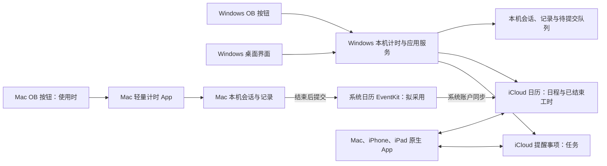

# 架构设计

更新：2026-11-08。当前 Windows 桌面 0.1.2、OB 0.8.1 轻量连接；旧完整插件只保留 0.7.0 发布物用于迁移，当前源码入口不再运行旧模式。已有用户已完成交接和备注往返，平台验收仍需继续；Mac App 待开发。需求以[产品需求](1-产品需求.md)为准。

## 1. 每台电脑的职责

Windows 与 Mac 的活动会话之间没有云端同步链路。每台电脑内只有一个计时权威；云端共享任务、日程和已结束记录。本机界面可以重开，计时状态不由窗口或 OB 页签持有。

## 2. 数据归属

| 数据 | 权威位置 | 处理原则 |
| --- | --- | --- |
| 活动计时、暂停状态 | 发起电脑的持久日志 | 不上传，不跨设备接管；本机重启恢复 |
| 已结束但尚未提交的工时 | 发起电脑的记录与提交日志 | 结束先落盘，确认提交后更新状态，不删除唯一副本 |
| 任务 | iCloud 提醒事项 | Windows 编辑；Apple 原生 App 继续管理；Mac 计时首版不写任务 |
| 日程、已结束工时 | iCloud 日历 | 保持计划与实际语义、稳定记录身份，禁止按标题去重 |
| OB 课题与任务关联 | 本机应用的稳定映射，OB 提供笔记上下文 | 迁移保留旧 TaskRef／别名，路径变化需明确更新 |
| 账户凭据与系统日历授权 | 各端受保护存储／系统授权 | OB 连接插件不持有云端凭据 |
| 日记正文和已生成快照 | OB 笔记库 | 保留 Markdown 与手写区，不迁入计时数据库 |

每条新工时在本机生成稳定 ID；记录来源电脑、可选任务引用、标题／分类快照、UTC 起止、暂停区间和净时长。Windows 与 Mac 的日历标记、UID／事件标识和展示含义需要互操作验证，不能仅凭同名或相近时间认定为同一条记录。

安排日期保留浮动日期，时刻保存 UTC 并保留所需原时区，日期截止不随显示时区换日。现有 Markdown 的日期已用作截止，不在迁移时同时填成安排日期。提醒事项的应用扩展字段必须验证原生编辑后的往返，不能假定任意 CloudKit 自定义字段可用。

## 3. 本机计时与 OB 连接

左侧快捷入口使用插件持有的样式表，按精确 aria-label 隐藏四个指定按钮，兼容旧版 mod-left 与 1.15 的 mod-primary 容器。样式覆盖晚注册／重建，不轮询或改写 workspace.json；独立设置默认开启，关闭或卸载时撤销样式，遵循 Obsidian 自身的隐藏配置。

Windows 使用 Tauri 2 管理窗口、托盘及系统事件，独立 Node 后台拥有唯一计时和云端队列，固定 Python 适配器按需启动。运行时随安装包提供，正常启动不下载 SDK 或执行 pip。Mac 由轻量 App 管理，不移植整套 Windows 运行时。

Tauri 安装后的资源目录可能带 Windows 扩展路径前缀。Node 24.14.0 对该入口做 JS realpath 时已复现驱动器根目录 EISDIR；0.1.1 宿主按 [Node 模块启动选项](https://nodejs.org/download/release/v24.14.0/docs/api/cli.html#--preserve-symlinks-main)保留主模块和导入路径，选项与安装路径测试共享。路径不通过拼接 shell 命令传递，仍使用独立进程参数。

隐藏窗口时调用 WebView2 `TrySuspend`，显示时恢复并重新加载状态；计时与同步始终在 Node 中继续。该行为依据 [Microsoft WebView2 后台资源说明](https://learn.microsoft.com/en-us/microsoft-edge/webview2/reference/win32/icorewebview2_19)。Python 完成最后一项请求后空闲 30 秒退出，下次请求重新启动并读取受保护会话；验证码等待期间保留进程。占用达标情况必须按完整进程树重新实测。

桌面与 OB 0.7.0 完整模式使用当前用户的 OS 命名管道互斥，退出或崩溃时由系统释放；启动失败也必须退出，不能持有互斥等待。旧 0.6.1 不识别新互斥，仍须先升级并显式冻结交接。未导入交接或明确确认独立使用前，桌面禁止计时及业务提交；该确认不是跨设备锁。离线示例使用独立目录并阻止真实账户、迁移与云写入。

Windows 本机协议为 v1 回环 HTTP＋SSE，使用随机端口、随机令牌和仅当前用户／SYSTEM 可读的数据目录；拒绝浏览器 Origin 及非本机 Host。Tauri 界面通过 Rust 命令转发，OB 通过 Node HTTP 连接；`ctt-desktop://` 用于唤起。接口覆盖计时、任务／安排／排序／撤销、日程／工时编辑、状态、日期快照及受控迁移，不向外网暴露控制端口。

指令携带唯一请求 ID、稳定课题／任务引用；暂停、继续、结束还必须携带期望的会话 ID。后台在本机串行执行，业务变更与请求确认写入同一原子提交后才返回；同一请求重试返回原结果，复用 ID 携带不同内容会拒绝。旧按钮快照不能结束后来启动的新会话。

桌面原子快照保留上一份有效数据；旧文件已经 fsync 时，通过硬链接保留其持久内容，避免每次点击重复重写整个历史。文件系统不支持时保守回退到写入并 fsync 备份；损坏主文件先保留损坏副本，再从有效备份恢复，不拿损坏字节覆盖备份。实际性能单独测量。

连接插件只负责卡片增强、轻量状态订阅和显示，不拥有 TimerController、云端 Worker 或第二份可写会话日志。App 未运行时先唤起并等待连接；失败显示未连接，不能在 OB 内悄悄回退为另一套计时。关闭 OB 只断开订阅，不结束本机会话。

按钮按稳定身份发送意图，不发送整个笔记正文。日记更新继续作为独立的快照适配：读取桌面日期快照，由 OB 沿用原日期、模板、生成区保护和备份规则；手动入口及原 Templater 自动入口均保留，不重新引入同步引擎。

安排日期使用浮动日期，放入提醒事项 `[CalendarTaskTimer:v1]` 应用备注区，和原截止字段独立。只有专用样例经 Apple 原生编辑往返核对后才解锁真实安排。撤销为受保护的反向更新；只合并明确标记从未发送的备注操作，已发送／旧版不确定队列保持固定内容和身份。普通重复任务推进下一周期时清除原安排日期，历史保留原快照。

## 4. Windows 核心与云端通道

迁移复用现有 `Coding/Shared` 的计时、恢复、幂等与同步规则，以及 `Providers/Calendar` 和 `Providers/Reminders` 的已验证能力。将 `Clients/Obsidian` 中的存储、认证与子进程生命周期接线迁到桌面宿主；不能直接把现有插件入口当成独立服务运行。

核心状态先持久化，本机短锁不等待远端网络。工时按稳定 UID 条件写入；不确定创建先核对原身份，网络退避重试，外部 revision／ETag 冲突停止覆盖。任务、工时、日程保留各自语义，删除墓碑和未确认意图继续保留。

“结束并完成”分两个可追踪步骤：工时确认后，再完成原提醒事项或已验证的当前周期。二者不宣称是跨服务原子事务；失败只补未确认步骤。周期规则沿用已确定政策，复杂规则和结构任务继续保护，不按标题恢复失去身份的原生实例。

现有提醒事项后台使用固定版本 Python 适配器，运行时的目录保护、文件锁等有 Windows 专用实现。这些作为 Windows 迁移对象，不构成 Mac 兼容证据。账户、会话、原生对象 ID 和请求线报体不放入公开文档或 Git。

## 5. Mac 轻量实现

建议采用 SwiftUI 的菜单栏入口／小窗口及 EventKit。该路线使用系统已登录的日历账户；首版不移植 Windows 提醒事项 Python 后台，也不要求读取完整任务库。具体最低 macOS 版本及界面形态在原型阶段确认。

1. 开始：生成本机会话 ID，保存活动名称、目标工时日历和计时起点，确认后更新界面；不发送活动状态到 iCloud。
2. 暂停／继续：更新本机区间和状态；隐藏窗口或关闭 OB 不影响会话。
3. 结束：冻结净时长与实际区间，先原子保存稳定工时 ID 及“待写日历”状态。
4. 提交：向已配置的可写 iCloud 日历保存事件，保存事件标识及可恢复的关联信息；由系统账户同步后续云端变化。
5. 失败：权限拒绝、日历消失／不可写或保存异常保留原记录，提示重试。系统本地保存成功不等同于远端上传已确认。

App 在读取、选择和核对事件时所需的权限，要与“仅新增事件”区分。Apple 的写入权限不提供事件读取能力；如果选择目标日历、崩溃后查重或读取自有记录需要完整访问，应据实际功能申请并解释，不宣称仅写权限已覆盖这些能力。Mac 沙盒日历权限、授权变化和 iCloud 目标识别均需真机验证。

提交日志必须覆盖“系统已保存事件但 App 尚未写回确认便退出”的窗口；复用稳定记录标记及系统事件标识进行核对，不能重启后盲目再次创建。Windows 读取 Mac 工时的识别方式也需先用专用样例验证，避免把它当成普通计划或生成第二份工时。

计时从持久化时间段推导，不靠每秒 tick 累加。暂停不计入，系统睡眠／唤醒和异常退出后的时长边界需核对；不能把长时间关机直接自动算入有效工时。

技术依据：[MenuBarExtra](https://developer.apple.com/documentation/swiftui/menubarextra)、[访问 EventKit 事件存储](https://developer.apple.com/documentation/eventkit/accessing-the-event-store)。以上是设计依据，不代表 Mac 原型已运行。

## 6. 迁移与验收门槛

旧迁移桥接版 0.7.0 保留自身 TimerController、日志、账户适配和同步队列；当前 0.8.0 不包含这些宿主实现。尚未迁移时用桥接版冻结快照，保留原任务 ID、Components 绑定、已确认工时、未确认操作、重试身份和原生日历来源；不得让旧宿主与桌面同时写同一业务状态。

切换时先结束旧计时并核对待同步队列，备份后受控导入；未确认提交按原身份核对，不能重放已经完成的写入。新宿主接管凭据要用受保护迁移或重新授权，不能把旧安全存储导出成普通 JSON。新后台与按钮端到端验收后，停止旧完整插件的计时／同步职责。

必须验证：本机单会话、重复点击与丢响应、迟到的旧指令、OB 关闭后继续、App 崩溃恢复、Windows 断网和冲突、Mac 权限／离线／睡眠／重复写入、两端已结束工时互认、原有绑定与日记内容保留。真实账户验证使用明确的专用样例，并分别记录模拟测试与实机结果。

跨设备活动计时、全局互斥和远端接管不在本轮范围。Mac 的独立运行不是 Windows 后台的远程控制模式。
